# Umbra — pitch deck

**Pay anyone. Hide everything.** A zero-knowledge privacy layer for payments, requests and swaps on Portaldot V3.

📄 **[Download the PDF](Umbra-Pitch-Deck.pdf)** (11 slides, 3 MB) · 🌐 [Live app](https://umbrav1.up.railway.app) · 🎬 [Demo video](https://www.youtube.com/watch?v=hMTj8YFXGWM) · 💻 [Source code](https://github.com/drained69/umbra)

The deck covers: the problem (slides 2–3), the product and how it works (4–5), why Portaldot is essential (6), proof of functionality (7–8), and reasons for continued support (9–10).

---

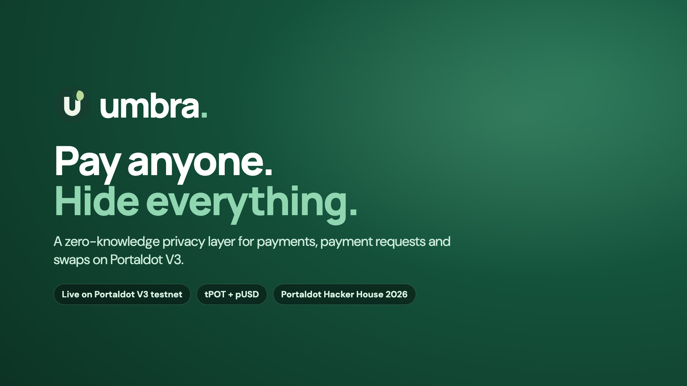

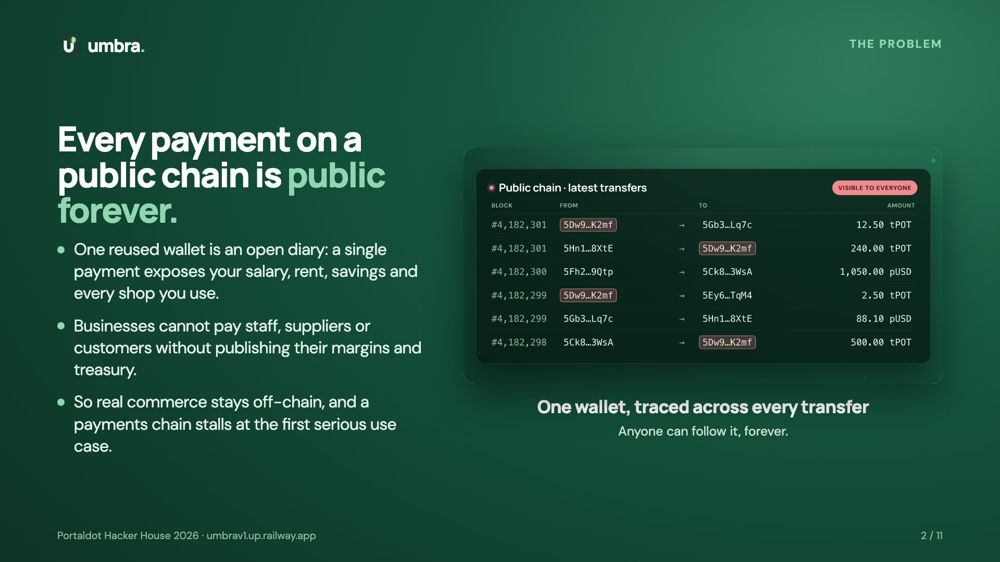

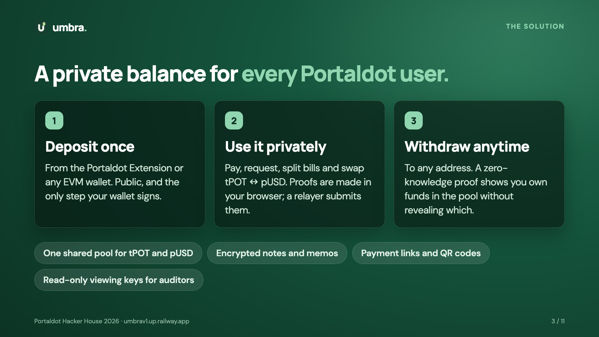

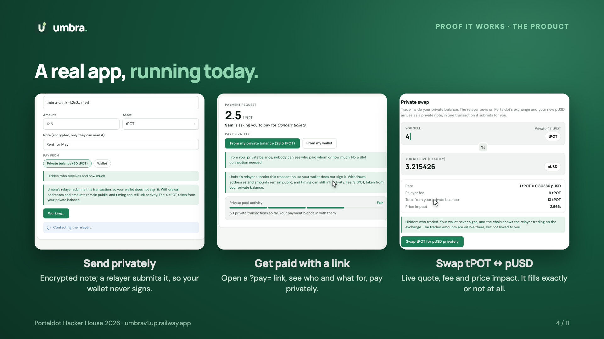

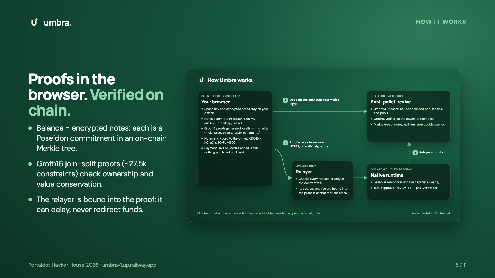

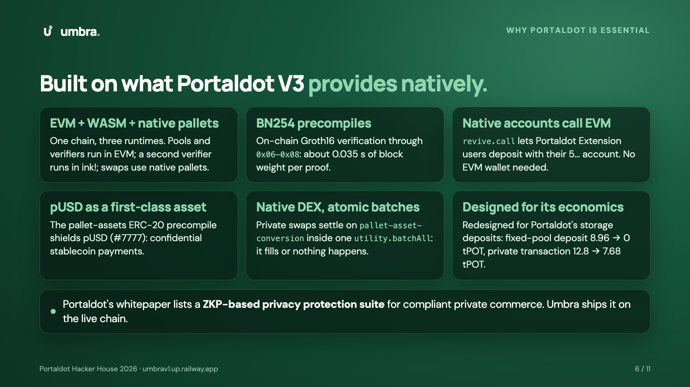

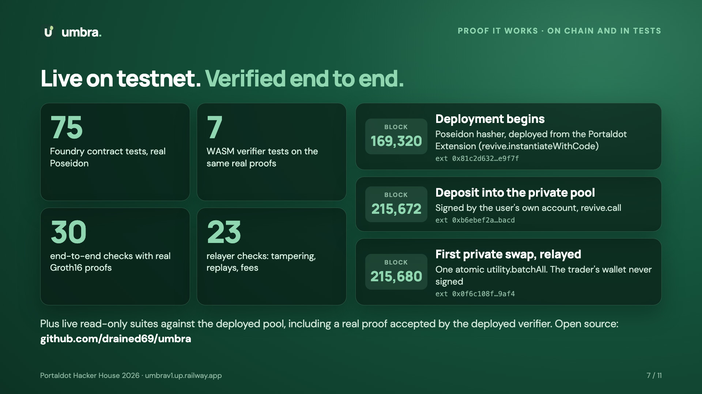

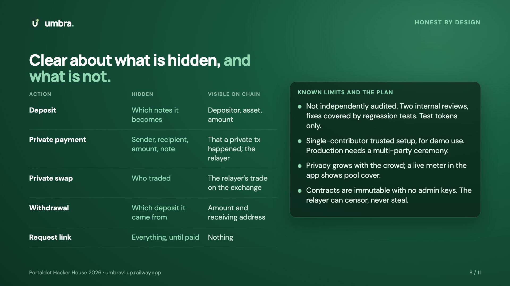

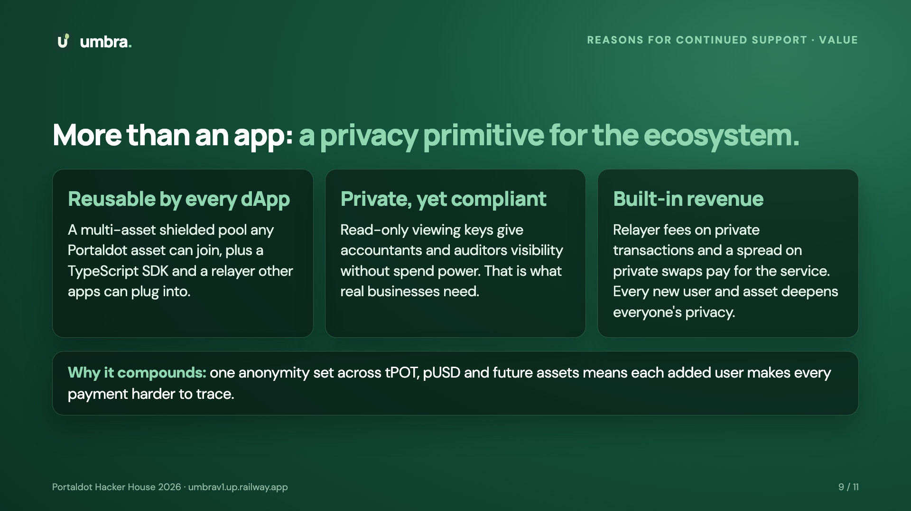

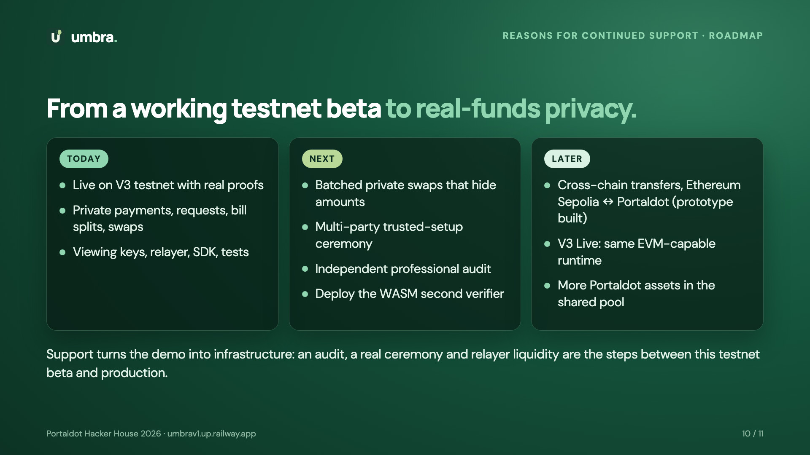

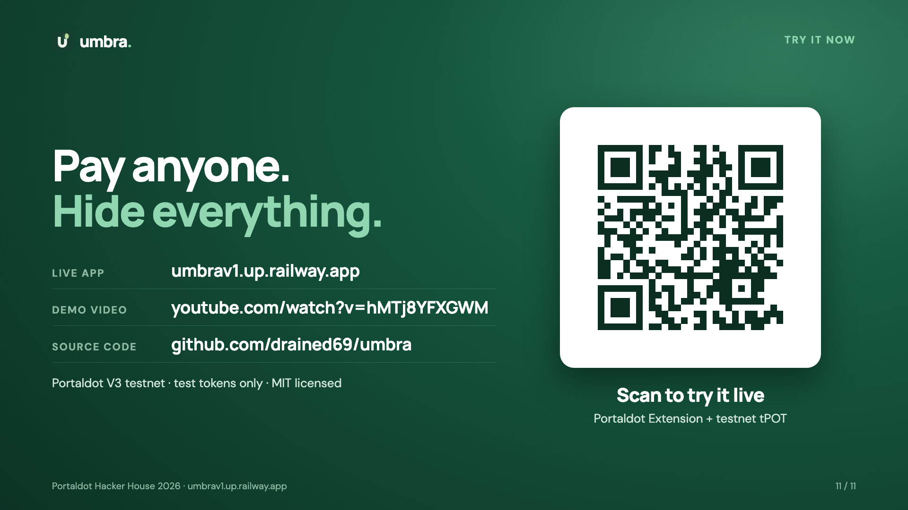
